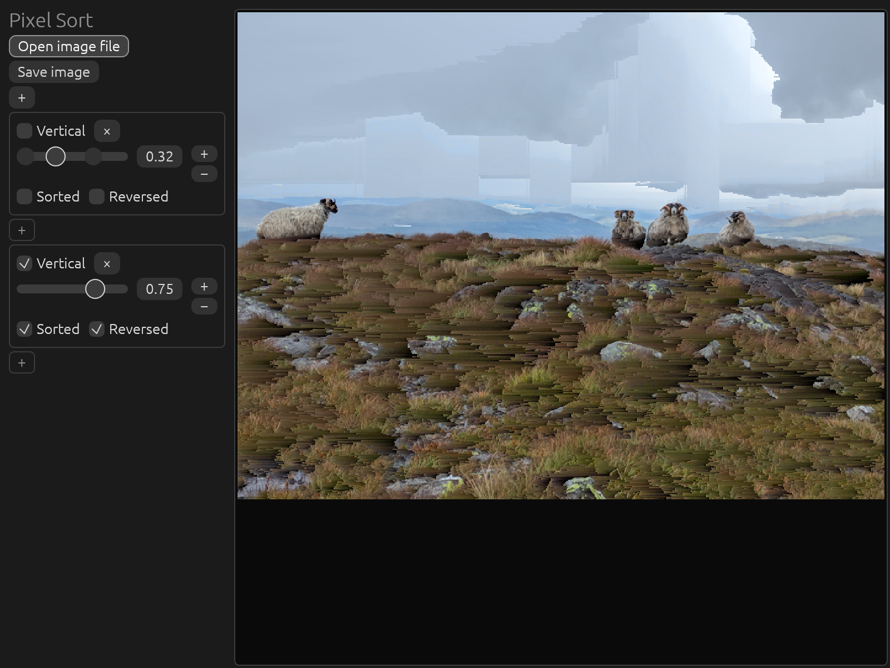

# Pixel Sort

Pixel sorting is an [algorithmic art](https://en.wikipedia.org/wiki/Algorithmic_art) technique based around applying sorting algorithms to images.

[Higher definition example](examples/source%20pixel-sorted.jpg)

Recently, I've been playing around with GPU programming (with [wgpu](https://github.com/gfx-rs/wgpu)) and I was reminded of [Acerola's video](https://youtu.be/HMmmBDRy-jE), where he implements pixel sorting on the GPU. However, for speed, he compromises on the quality of the sort by limiting the span length. I had another idea of how to improve the performance with no compromises and this is the result.

## Current State
This crate is in rapid development and breaking changes are being made frequently. As such, the code is a bit messy, barely tested, and completely undocumented. My current goal is to add all the features I want / can think of. Once that is complete, I will work on tidying it up, and stabilising and documenting the API.

## App
The included app (`pixel-sort-app` package) is an [egui](https://www.egui.rs/)-based program for interacting with pixel sorting without the need for code.

`cargo run -p pixel-sort-app`

## Licenses
The `PixelSort` project (library and app) is dual-licensed under either the MIT license or the Apache License Version 2.0 at your option.  
`examples/source.jpg`, `examples/source pixel-sorted.jpg`, and `comparison.png` © 2026 Tom Boddaert. All Rights Reserved. May be distributed, unmodified, as part of this repository (<https://github.com/tomBoddaert/PixelSort>) and any forks, with this license note attached.
